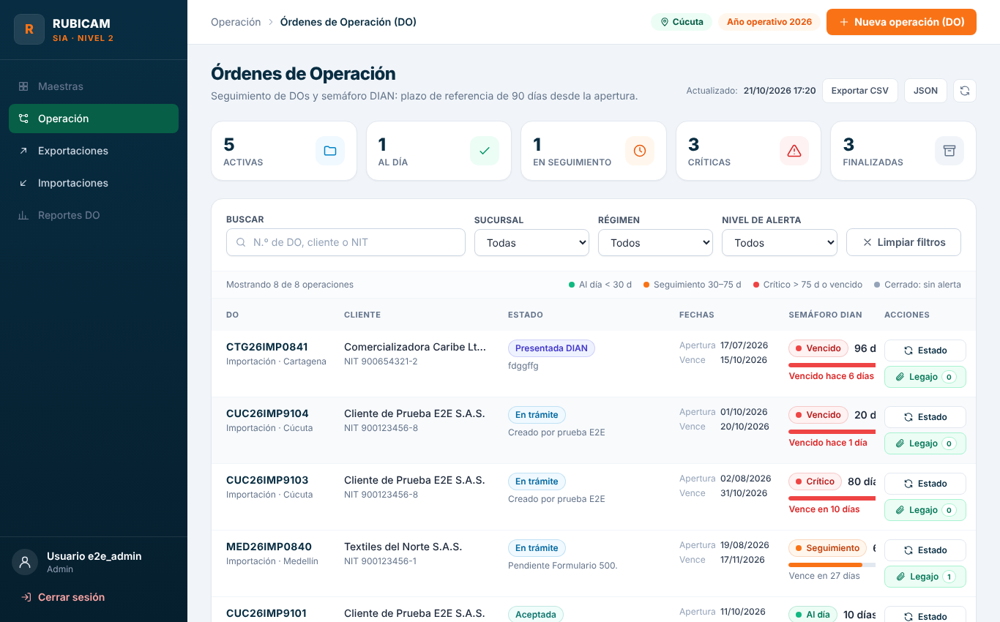
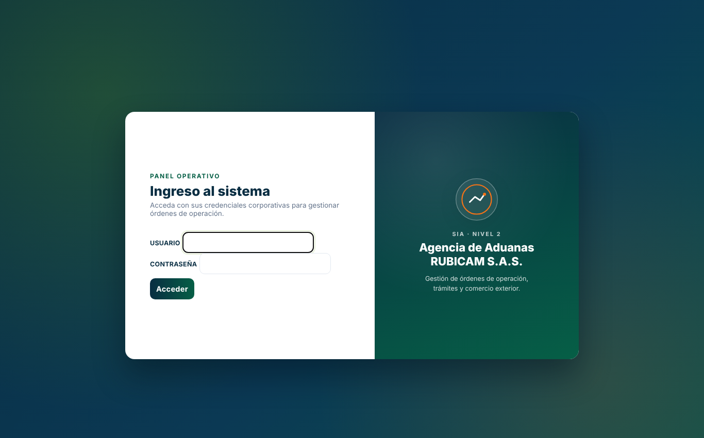
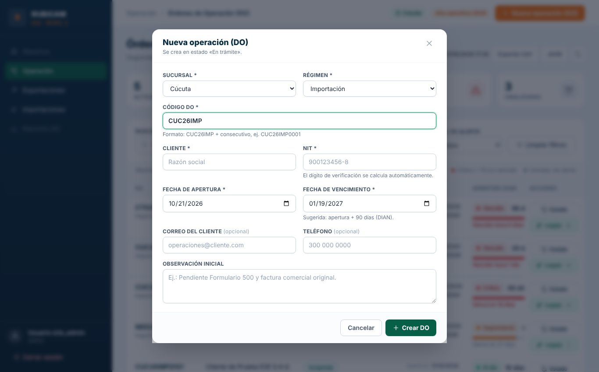

# Informe técnico: aplicación de los principios de codificación y pruebas al sistema Rubicam

| | |
|---|---|
| **Institución / programa** | FESC — Ingeniería de Software |
| **Asignatura** | Codificación y Pruebas del Software |
| **Estudiante** | **[NOMBRE COMPLETO DEL ESTUDIANTE]** |
| **Docente** | **[NOMBRE DEL DOCENTE]** |
| **Fecha** | 21 de octubre de 2026 |
| **Proyecto** | Landing y panel operativo de Órdenes de Operación (DO) de *Agencia de Aduanas Rubicam S.A.S.* |
| **Versión entregada** | `v2.1.0` (línea base recibida: `v2.0.0`) |
| **Repositorio** | `[URL DEL REPOSITORIO EN GITHUB]` |

> **Cómo leer este informe.** La guía de aprendizaje pide como producto un *reporte técnico en Markdown con captura de ejecución de linters y pruebas de regresión*,
> un módulo con arquitectura modular, codificación defensiva, un repositorio con historial de commits estructurado y la explicación del flujo TDD.
> Cada requisito tiene su sección (ver la tabla 1.2). Todas las capturas de este informe son **salidas reales** copiadas de `docs/evidencias/`; no hay cifras escritas a mano.

## Resumen ejecutivo

Se recibió un sistema PHP en funcionamiento pero sin pruebas automáticas, con toda su lógica en **funciones globales** (3 873 líneas, 0 clases),
un archivo de 1 835 líneas que mezclaba SQL, reglas de negocio, HTML y 900 líneas de JavaScript, y **fallas de seguridad reales**
(el volcado SQL con datos de clientes se podía descargar desde el navegador). Sobre ese sistema se aplicaron, en orden, los temas de la asignatura:

1. **Documentación y pruebas previas** (especificación, casos de prueba y auditoría forense con 19 hallazgos) *antes* de modificar código.
2. **Red de seguridad**: 28 pruebas de extremo a extremo que fijan el comportamiento visible, para poder refactorizar sin miedo.
3. **Mantenimiento correctivo** de 6 defectos con **pruebas de regresión que primero fallan** (RED) y luego pasan (GREEN).
4. **Refactor modular con TDD** (Red → Green → Refactor): 38 clases `final` en capas, codificación defensiva y validación de entradas.
5. **Mantenimiento adaptativo, preventivo y aditivo** (configuración por `.env`, CSP estricta, exportación CSV/JSON) clasificado según **ISO/IEC/IEEE 14764:2022**.
6. **Herramientas de apoyo**: PHPCS (PSR-12), PHPMD, un escáner de seguridad estático propio (equivalente a *bandit*), PHPUnit con cobertura, integración continua y depuración.
7. **Despliegue**: Git con ramas por solicitud de cambio, Conventional Commits, versionado SemVer, entornos por variables y plan de reversión.

| Indicador | Antes (`v2.0.0`) | Después (`v2.1.0`) |
|---|---|---|
| Pruebas automáticas | **0** | **424** unitarias/regresión (743 aserciones) + **36** E2E + **21** comprobaciones contra Apache real |
| Clases / espacios de nombres | 0 / 0 | 38 clases `final` / 8 |
| PHPCS (PSR-12) | **56 errores y 249 advertencias** | **0 y 0** |
| PHPMD (sin la regla `StaticAccess`) | 44 hallazgos (CC hasta 25, NPath 207 360, 7 `exit`, 3 `@`) | 5 (las excepciones documentadas `$id` y `h()`); CC máxima **8** |
| Escáner de seguridad | 28 hallazgos (27 medios, 1 bajo) | **0** (2 supresiones con motivo escrito) |
| Archivos internos descargables (Apache real) | **200** en `SQL/rubicam_db.sql` y `README.md` | **403** en las 19 rutas internas probadas |
| Accesos a globales / superglobales | 101 / 41 | 42 / 9 |
| Cobertura de líneas (pruebas unitarias) | 0 % | Dominio **100 %**, Publico **100 %**, escáner **99 %**, global 55,7 % (el resto se verifica con E2E; ver §7.5) |
| Funciones nuevas | — | Exportación CSV/JSON, configuración por entorno, escáner de seguridad |
| Historial de Git | 1 commit importado | 54 commits en `main` y 14 ramas con propósito (`fix/`, `feature/`, `refactor/`, `test/`, `docs/`, `chore/`); las de corrección y evolución con su commit `[RED]` y su commit `[GREEN]` |

**Resultado funcional:** las 28 pruebas E2E escritas *antes* del refactor siguen en verde **sin haber modificado su resultado esperado**, y el panel se comprobó en un
navegador real (Chromium) bajo la nueva política CSP estricta: 0 violaciones de CSP y 0 errores de JavaScript (§7.7).

## 1. Contexto, objetivos y mapa de evidencias

### 1.1 Objetivo

Aplicar a un sistema real los principios de **preparación para la codificación**, de **programación** (legibilidad, modularidad, mantenibilidad), de **despliegue**,
la **seguridad y validación de entradas**, la **codificación defensiva con TDD**, el uso de **linters, analizadores estáticos y depuración**, y el **mantenimiento de software**
(correctivo, preventivo, adaptativo, perfectivo, aditivo) con **pruebas de regresión y trazabilidad**.

### 1.2 Dónde se evidencia cada requisito de la guía

| Requisito de la guía | Evidencia | Sección |
|---|---|---|
| Actividad 1 — Análisis forense: tipos de error, impacto ISO/IEC 25010, analizador estático de seguridad | `docs/03_AUDITORIA_CODIGO.md` (19 hallazgos) · `tools/escanear_seguridad.php` · `docs/evidencias/antes-07-escaner.txt` | §3 |
| Actividad 2 — TDD (Red-Green-Refactor), validación defensiva, linter | `tests/` · `src/` · historial `[RED]`/`[GREEN]`/`[REFACTOR]` · `docs/evidencias/tdd/` · `phpcs.xml` | §4 |
| Actividad 3 — Mantenimiento correctivo + evolutivo sin regresiones, ramas y Conventional Commits | `docs/04_PLAN_DE_MANTENIMIENTO.md` · ramas `fix/*` y `feature/*` | §5 |
| Producto: módulo con arquitectura modular y limpia | `src/` (capas) · `docs/01_ESPECIFICACION.md` | §4.3 |
| Producto: codificación defensiva y validación estricta de entradas | `Sanitizador`, `ValidadorNuevoDo`, `Nit`, `PoliticaArchivos`, `Guardia` | §4.4 |
| Producto: repositorio con historial de commits estructurado | `git log --oneline --graph` | §5.4, §8 |
| Producto: reporte técnico con captura de linters y pruebas de regresión | este informe | §7 |
| Desempeño: explicar el flujo TDD | §4.1–4.2 | §4 |
| Desempeño: interpretar y corregir advertencias de consola (linter, analizador, pruebas) | §6 y §7 | §6, §7 |
| Conocimiento: normas ISO/IEC 25010, tipos de error, tipos de mantenimiento | `docs/03`, `docs/04` | §3, §5 |
| Declaración ética de uso de IA (con referencias APA) | §11 y §12 | §11 |

## 2. Herramientas: del ecosistema Python de la guía al ecosistema PHP del proyecto

La guía usa Python (`pytest`, `flake8`, `pydantic`, `bandit`) porque sus ejemplos son en Python. El proyecto entregado es **PHP**, así que se aplicó
**el mismo método con las herramientas equivalentes** (decisión explícita; el objetivo de aprendizaje es la práctica, no el lenguaje):

| Propósito | En la guía (Python) | En este proyecto (PHP) | Nota |
|---|---|---|---|
| Pruebas unitarias xUnit | `pytest` | **PHPUnit 9.6** | `phpunit.xml.dist`, `@group MR-nnn` para regresión |
| Linter de estilo | `flake8` (PEP 8) | **PHP_CodeSniffer** con **PSR-12** | `phpcs.xml`; líneas ≤ 120 columnas |
| Análisis estático (complejidad, código muerto) | `pylint` / `flake8` (McCabe) | **PHPMD** | `phpmd.xml`; CC ≤ 10, NPath ≤ 200 |
| Analizador estático de seguridad | `bandit` | **Escáner propio** `tools/escanear_seguridad.php` (9 reglas) | No existía un `bandit` mantenido para PHP en el entorno; se construyó con TDD analizando *tokens* (§4.6) |
| Validación defensiva de datos | `pydantic` | `Sanitizador` + `ValidadorNuevoDo` + `Nit` | Validación en el servidor, tipos estrictos (`declare(strict_types=1)`) |
| Cobertura | `pytest-cov` | **PCOV** | `composer test:cobertura` |
| Entorno virtual | `venv` | Composer (solo desarrollo) | En producción no hace falta Composer: autocargador PSR-4 propio |
| Depurador | `pdb` / IDE | **Xdebug** + `.vscode/launch.json` | §9 |

## 3. Actividad 1 — Análisis forense del código heredado

**Método** (detalle en `docs/03_AUDITORIA_CODIGO.md`): lectura completa del código; ejecución de `php -l`, `phpcs`, `phpmd`, `phploc` y del escáner sobre la etiqueta `v2.0.0`;
**reproducción real** de cada sospecha con un script (no se reporta un defecto que no se pudo demostrar); clasificación por **tipo de error** y por **característica ISO/IEC 25010**.

### 3.1 Resultado de las herramientas sobre la línea base

**PHPCS (PSR-12) — resumen por archivo:**

<p class="fuente">Fuente: <code>docs/evidencias/antes-02-phpcs-resumen.txt</code>, líneas 1–17</p>

```text

PHP CODE SNIFFER REPORT SUMMARY
----------------------------------------------------------------------
FILE                                                  ERRORS  WARNINGS
----------------------------------------------------------------------
index.php     7       95
...aude/work/proj/rubicam-redesign/config/config.php  2       1
...e/work/proj/rubicam-redesign/config/config_db.php  2       5
...de/work/proj/rubicam-redesign/config/security.php  11      2
.../proj/rubicam-redesign/handlers/quote-handler.php  8       1
...oj/rubicam-redesign/handlers/upload_documento.php  2       6
...roj/rubicam-redesign/handlers/webhook_trigger.php  2       7
...de/work/proj/rubicam-redesign/panel/dashboard.php  15      130
...claude/work/proj/rubicam-redesign/panel/index.php  5       2
...laude/work/proj/rubicam-redesign/panel/logout.php  2       0
----------------------------------------------------------------------
A TOTAL OF 56 ERRORS AND 249 WARNINGS WERE FOUND IN 10 FILES
```


**PHPCS — por regla (el 80 % son líneas largas):**

<p class="fuente">Fuente: <code>docs/evidencias/antes-02b-phpcs-por-regla.txt</code>, líneas 1–15</p>

```text

PHP CODE SNIFFER VIOLATION SOURCE SUMMARY
----------------------------------------------------------------------
    STANDARD  CATEGORY            SNIFF                          COUNT
----------------------------------------------------------------------
[ ] Generic   Files               Line length too long           242
[x] PSR12     Files               File header spacing after blo  22
[x] Squiz     Control structures  Control signature space after  16
[x] Generic   Control structures  Inline control structure not   13
[ ] PSR1      Files               Side effects found with symbo  7
[x] Generic   White space         Scope indent incorrect         3
[x] Generic   Files               Line endings invalid EOLChar   1
[x] Generic   White space         Scope indent incorrect exact   1
----------------------------------------------------------------------
A TOTAL OF 305 SNIFF VIOLATIONS WERE FOUND IN 8 SOURCES
```


**PHPLOC — tamaño y estructura:** 3 873 líneas, **0 clases**, 0 espacios de nombres, 410 líneas lógicas en funciones globales y 101 accesos a variables o constantes globales.

**PHPMD — 47 hallazgos** (extracto de los más graves): `validar_nuevo_do` con complejidad ciclomática (CC) **25** y NPath **207 360**; `accion_descargar` CC 13; `exit` dentro de 7 funciones (no se pueden probar); operador `@` que oculta errores en 3 sitios.

**Escáner de seguridad (equivalente a *bandit*) sobre la línea base:**

<p class="fuente">Fuente: <code>docs/evidencias/antes-07-escaner.txt</code>, líneas 1–3</p>

```text
$ php tools/escanear_seguridad.php --umbral=bajo config handlers panel index.php    # el escáner de main aplicado al código de la línea base v2.0.0
config/security.php:85  [BAJO] SEG-008  md5() no sirve para claves ni tokens: use random_bytes.
handlers/quote-handler.php:28  [MEDIO] SEG-009  Lectura directa de $_POST: use Solicitud.
```

<p class="fuente">Fuente: <code>docs/evidencias/antes-07-escaner.txt</code>, líneas 30–32</p>

```text

Total: 28 hallazgo(s) — alto: 0, medio: 27, bajo: 1
(código de salida: 1 → falla la compuerta)
```


> *Interpretación.* Los 25 hallazgos `SEG-009` indican que las entradas del usuario (`$_POST`, `$_GET`, `$_FILES`) se leen sin un único punto de control, repartidas por 4 archivos;
> el `SEG-008` es `md5()` usado como nombre de archivo (no protege un secreto; se justificó con una nota en el código nuevo); los 2 `SEG-004` eran consultas armadas con una
> variable `$sql` fija a la que se añade un `WHERE` con parámetro: **no** eran inyección SQL, pero el patrón se presta a error y se reemplazó por una constante de clase.

### 3.2 Hallazgos verificados (resumen)

Los 19 hallazgos completos, con evidencia reproducible, están en `docs/03_AUDITORIA_CODIGO.md`. Los más importantes:

| ID | Hallazgo | Tipo de error | ISO/IEC 25010 | Severidad | Impacto en el negocio |
|---|---|---|---|---|---|
| H-05 | `SQL/rubicam_db.sql` (con hash de contraseña y datos de clientes), `README.md`, `composer.json` y el código de `handlers/` **descargables por HTTP** | De seguridad (exposición de información) | Seguridad — confidencialidad | **Alta** | Fuga de datos de clientes; incumplimiento de la Ley 1581 de 2012 |
| H-06 | Login sin límite de intentos y con `password_verify` solo si el usuario existe (se podía **enumerar usuarios por tiempo de respuesta**) | De seguridad | Seguridad — autenticidad | **Alta** | Acceso no autorizado al panel de operaciones |
| H-01 | `clean_number('1e999')` → `INF`: el servidor aceptaba notación científica que el cliente sí rechazaba | Lógico | Fiabilidad · Seguridad (integridad) | Media | `INF` llegaba al correo del asesor |
| H-02 | `'-------'` pasaba como teléfono (se contaban *caracteres*, no *dígitos*) | Lógico | Adecuación funcional | Media | Asesores sin forma de contactar al cliente |
| H-03 | `origen`/`destino` sin longitud máxima (se aceptaron 5 000 000 de caracteres) | De ejecución (DoS) | Eficiencia · Seguridad (disponibilidad) | Media | Correo y servidor saturados |
| H-04 | `calcular_dv_nit('abc12')` devolvía `9` **en silencio** | Lógico (sin codificación defensiva) | Fiabilidad (tolerancia a fallos) | Baja | Dato corrupto sin aviso |
| H-09/10 | Un archivo de 1 835 líneas; `validar_nuevo_do` con CC 25 y NPath 207 360 | De diseño | Mantenibilidad — modularidad, analizabilidad | Media | Cada ajuste a una regla DIAN es caro y riesgoso |
| H-12 | `exit` dentro de funciones y operador `@` | De estilo / diseño | Mantenibilidad · Fiabilidad | Baja | Código imposible de probar; errores de E/S ocultos |

### 3.3 Tipos de error utilizados

| Tipo | Significado | Ejemplo real aquí |
|---|---|---|
| **Sintáctico** | No cumple la gramática; lo detecta `php -l` | Ninguno: los 10 archivos pasaron `php -l` (el código *compilaba*; los problemas estaban en la lógica y la seguridad) |
| **Lógico** | Corre pero da un resultado incorrecto | H-01, H-02, H-04 |
| **De ejecución** | Falla con ciertos datos o entorno | H-03 |
| **De seguridad** | Permite a un tercero leer, alterar o negar el servicio | H-05, H-06 |
| **De estilo / diseño** | No rompe, pero degrada la mantenibilidad | H-08 a H-15 |

> *Lección para el informe:* que un programa **compile y funcione** no significa que sea correcto ni seguro. El análisis estático y las pruebas encuentran lo que el "probé y anda" no ve.


## 4. Actividad 2 — TDD, arquitectura modular y codificación defensiva

### 4.1 El flujo TDD (Red → Green → Refactor), explicado

**TDD** (*Test-Driven Development*, Beck, 2003) invierte el orden habitual: **primero la prueba, después el código**. Ninguna línea de producción se escribe sin una prueba que falle y que la justifique.

```
   ┌──────────────┐        ┌───────────────┐        ┌────────────────┐
   │  1. RED      │  ───►  │  2. GREEN     │  ───►  │  3. REFACTOR   │ ──┐
   │ escribir una │        │ el código más │        │ limpiar el     │   │
   │ prueba que   │        │ simple que    │        │ diseño con las │   │ siguiente
   │ FALLA        │        │ la haga pasar │        │ pruebas en     │   │ comportamiento
   └──────────────┘        └───────────────┘        │ verde          │   │
        ▲                                           └────────────────┘   │
        └──────────────────────────────────────────────────────────────────┘
```

1. **RED.** Se escribe la prueba de un comportamiento que todavía no existe (o que está mal) y se ejecuta: **debe fallar, y por la razón correcta** (un `assertNull` que recibe `1000.0`, no un error de sintaxis). Esto demuestra que la prueba *puede* detectar el problema; una prueba que nunca ha fallado no prueba nada.
2. **GREEN.** Se escribe el cambio **mínimo** que la hace pasar. No se "adelanta" diseño ni se agregan casos que ninguna prueba pide.
3. **REFACTOR.** Con todo en verde se mejora el diseño (nombres, duplicación, complejidad) sin cambiar el comportamiento; si algo se rompe, las pruebas avisan al instante.

**Por qué sirve:** (a) obliga a pensar el *contrato* (entrada → salida) antes de programar; (b) deja una red de seguridad para refactorizar; (c) los casos límite (vacío, demasiado largo, malicioso) se piensan al principio, no cuando ya falló en producción; (d) la prueba **es** la documentación ejecutable del comportamiento.

**Cómo quedó evidenciado en este repositorio.** Cada ciclo deja **dos commits distintos** y, entre ellos, la salida real de la consola:

```
test(...) ... [RED]     ──► docs/evidencias/tdd/<ciclo>-rojo.txt   (la prueba falla)
feat/fix(...) ... [GREEN] ─► docs/evidencias/tdd/<ciclo>-verde.txt  (todo pasa)
```

### 4.2 Ejemplo trabajado completo: MR-001 (el importe aceptaba `1e999`)

**El defecto (código heredado, `config/security.php`):**

```php
function clean_number(?string $value): ?float
{
    $value = trim($value ?? '');
    return is_numeric($value) && (float) $value >= 0 ? (float) $value : null;
}
```

`is_numeric('1e999')` es verdadero y `(float) '1e999'` es `INF`: el servidor aceptaba un valor que el JavaScript del navegador sí rechazaba (regex `^\d+(\.\d{1,2})?$`), así que **el servidor no era autoritativo** y `INF` terminaba en el correo del asesor.

**Paso 1 — RED.** Se escribe la prueba de regresión (`tests/Regression/Mr001ImporteEstrictoTest.php`, `@group MR-001`) con un *data provider* de entradas inválidas:

<p class="fuente">Fuente: <code>tests/Regression/Mr001ImporteEstrictoTest.php</code>, líneas 18–49</p>

```php
/**
 * @group MR-001
 * @group regresion
 */
final class Mr001ImporteEstrictoTest extends TestCase
{
    /**
     * @dataProvider importesInvalidos
     */
    public function testImporteInvalidoEsRechazado(string $entrada): void
    {
        $this->assertNull(Sanitizador::importe($entrada), "El importe '{$entrada}' debía rechazarse.");
    }

    /**
     * @return array<string, array{string}>
     */
    public function importesInvalidos(): array
    {
        return [
            'notación científica'        => ['1e3'],
            'infinito por desbordamiento' => ['1e999'],
            'hexadecimal'                => ['0x1A'],
            'sin parte entera'           => ['.5'],
            'tres decimales'             => ['12.345'],
            'coma decimal'               => ['1,5'],
            'negativo'                   => ['-5'],
            'no es número'               => ['NaN'],
            'vacío'                      => [''],
            'sobre el máximo'            => ['1000000000000'],
        ];
    }
```


Se ejecuta **antes** de corregir y **falla** (captura real, `docs/evidencias/tdd/mr-001-002-rojo.txt`):

<p class="fuente">Fuente: <code>docs/evidencias/tdd/mr-001-002-rojo.txt</code>, líneas 1–20</p>

```text
PHPUnit 9.6.17 by Sebastian Bergmann and contributors.

Mr001Importe Estricto (Rubicam\Tests\Regression\Mr001ImporteEstricto)
 ✘ Importe invalido es rechazado with data set "notación científica"
   │
   │ El importe '1e3' debía rechazarse.
   │ Failed asserting that 1000.0 is null.
   │
   │ tests/Regression/Mr001ImporteEstrictoTest.php:33
   │

 ✘ Importe invalido es rechazado with data set "infinito por desbordamiento"
   │
   │ El importe '1e999' debía rechazarse.
   │ Failed asserting that INF is null.
   │
   │ tests/Regression/Mr001ImporteEstrictoTest.php:33
   │

 ✔ Importe invalido es rechazado with data set "hexadecimal"
```


**Paso 2 — GREEN.** El cambio mínimo (`src/Seguridad/Sanitizador.php`): regex anclada y estricta, más un tope para evitar valores absurdos:

<p class="fuente">Fuente: <code>src/Seguridad/Sanitizador.php</code>, líneas 60–74</p>

```php
    /**
     * Importe decimal estricto: mismo contrato que valida el navegador (/^\d+(\.\d{1,2})?$/).
     * Rechaza notación científica, hexadecimal, negativos e infinito (MR-001: is_numeric('1e999') daba INF).
     */
    public static function importe(?string $valor): ?float
    {
        $texto = trim($valor ?? '');
        if (!preg_match('/^\d+(\.\d{1,2})?$/D', $texto)) {
            return null;
        }

        $importe = (float) $texto;

        return $importe <= self::IMPORTE_MAXIMO ? $importe : null;
    }
```


Se ejecuta de nuevo y **pasa** (`docs/evidencias/tdd/mr-001-002-verde.txt`):

<p class="fuente">Fuente: <code>docs/evidencias/tdd/mr-001-002-verde.txt</code>, líneas 1–12</p>

```text
PHPUnit 9.6.17 by Sebastian Bergmann and contributors.

Mr001Importe Estricto (Rubicam\Tests\Regression\Mr001ImporteEstricto)
 ✔ Importe invalido es rechazado with data set "notación científica"
 ✔ Importe invalido es rechazado with data set "infinito por desbordamiento"
 ✔ Importe invalido es rechazado with data set "hexadecimal"
 ✔ Importe invalido es rechazado with data set "sin parte entera"
 ✔ Importe invalido es rechazado with data set "tres decimales"
 ✔ Importe invalido es rechazado with data set "coma decimal"
 ✔ Importe invalido es rechazado with data set "negativo"
 ✔ Importe invalido es rechazado with data set "no es número"
 ✔ Importe invalido es rechazado with data set "vacío"
```


**Paso 3 — REFACTOR y cierre.** La suite completa (unitarias + 28 E2E) sigue en verde; el cambio se integra con `git merge --no-ff`. Commits reales: `4379e67` (RED) → `517fda6` (GREEN) → `5047d7b` (merge).

> *Detalle que importa:* la `/D` del final de la expresión regular evita que `$` acepte un salto de línea final (`"12\n"`); es el tipo de caso límite que se piensa **al escribir la prueba**, no después.

### 4.3 Arquitectura modular: de funciones globales a capas

**Antes:** 10 archivos, 0 clases; `panel/dashboard.php` con 1 835 líneas (SQL + reglas + HTML + 900 líneas de JavaScript); funciones `responder()` duplicadas 4 veces; `exit` dentro de funciones.

**Después:** puntos de entrada delgados que arman una `Solicitud`, llaman a un controlador y emiten la `Respuesta`:

```
 index.php · panel/*.php · handlers/*.php           (entradas: 23 a 49 líneas cada una, salvo vistas HTML)
        │  Solicitud ─► Controlador ─► Respuesta
        ▼
 src/Panel · src/Publico                            (casos de uso: orquestan, no deciden reglas)
        │                         │
        ▼                         ▼
 src/Dominio  (PURO, sin I/O)     src/Infraestructura (PDO, cURL, .env) · src/Archivos · src/Seguridad · src/Http
 Nit · SemaforoDo · Bitacora ·
 ValidadorNuevoDo · Catalogos
```

**Reglas de dependencia** (verificables): el `Dominio` no usa `$_SERVER`, `$_SESSION`, PDO, cURL, `header()`, `exit` ni la hora del sistema (recibe la fecha por parámetro, por eso `SemaforoDo` se prueba con «hoy» fijo en 2026-10-21); los controladores **devuelven** un objeto `Respuesta`, nunca llaman `exit`; todo valor que cambia con el entorno llega por variable de entorno; las vistas no consultan la base de datos.

| Principio de la guía | Cómo se aplicó (dónde verlo) |
|---|---|
| **Legibilidad** | Nombres descriptivos del dominio en español (`SemaforoDo::calcular`, `Nit::digitoVerificacion`, `ValidadorNuevoDo`); métodos cortos (CC máxima **8**; promedio 2,61); PSR-12 verificado por PHPCS |
| **Modularidad** | 38 clases `final` con una responsabilidad; capas con dependencia en un solo sentido |
| **Mantenibilidad** | Sin código duplicado (un `Respuesta`, un `TokenCsrf`, un `PoliticaArchivos` para las extensiones que estaban en 3 sitios); constantes con nombre en vez de «números mágicos» (`DIAS_SEGUIMIENTO=30`, `DIAS_CRITICO=75`, `MAX_BYTES=60000`) |
| **Estructuras claras** | **Cláusulas de guarda** (retorno temprano) en vez de `if/else` anidados: ver `Autenticador::autenticar`, `Guardia`, `ControladorCotizacion::procesar` |
| **Comentarios útiles** | Comentan el **por qué**: p. ej. «HASH_DE_RELLENO: sirve para igualar el tiempo de respuesta y no revelar si el usuario existe» |

### 4.4 Codificación defensiva y validación de entradas

*Defensiva* = anticipar entradas anómalas o maliciosas para que el software no falle de forma impredecible. Técnicas aplicadas (todas con prueba):

| Técnica | Ejemplo en el código | Prueba |
|---|---|---|
| **Tipos estrictos** y firmas con tipos | `declare(strict_types=1);` en cada archivo; `importe(?string): ?float` | PHPMD, PHPCS |
| **Validar en el servidor** aunque el cliente ya valide | `ValidadorNuevoDo` devuelve un error **por campo**; el JavaScript es solo UX | `ValidadorNuevoDoTest` (23), E2E-09 |
| **Fallar rápido, no en silencio** | `Nit::digitoVerificacion('abc12')` lanza `InvalidArgumentException` (antes devolvía `9`) | `Mr004NitDefensivoTest` |
| **Listas blancas** (no listas negras) | extensiones permitidas (`pdf`, `jpg`, `jpeg`, `png`, `docx`); operaciones válidas del cotizador; columnas exportables | `PoliticaArchivosTest`, `ExportadorDoTest` |
| **Verificar el contenido, no el nombre** | `PoliticaArchivos`: extensión **y** tipo MIME real **y** firma interna (`%PDF-`, `getimagesize`, ZIP con `word/document.xml`) | E2E-16 (un PDF falso → 415) |
| **Límites** en todo lo que crece | cuerpo JSON ≤ 64 KB (413), profundidad ≤ 16, archivo ≤ 10 MB, bitácora ≤ 60 000 bytes, origen/destino ≤ 120 | `SolicitudJsonTest`, E2E-34 |
| **Inyección** | consultas preparadas (PDO sin emulación); `Sanitizador::correo` rechaza `\nBcc:`; el CSV neutraliza `= + - @` | `SanitizadorTest`, `ControladorCotizacionTest`, `ExportadorDoTest` |
| **Autenticidad / CSRF** | `hash_equals` en tiempo constante; token por sesión; orden fijo sesión → método → CSRF → rol | `GuardiaTest`, `TokenCsrfTest` |
| **No revelar información** | errores 500 genéricos (detalle al log); login con respuesta uniforme y hash de relleno | `RespuestaTest` (Ejecutor), `AutenticadorTest` |
| **Degradar con elegancia** | si el almacenamiento del límite de tasa falla, **permite** el intento y lo registra (disponibilidad sobre rigidez); si n8n falla, el estado **sí** queda guardado | `LimitadorTasaTest`, E2E-14 |
| **Mínimo privilegio** | roles `admin`/`operador` escriben; `consulta` solo lee y exporta | E2E-21, `GuardiaTest` |

### 4.5 Ciclos TDD del proyecto

| Ciclo | RED | GREEN (REFACTOR) | Pruebas que quedan |
|---|---|---|---|
| Regresión MR-001/002 | `4379e67`, `e81ad2c` | `517fda6` | `Mr001…`, `Mr002…`, E2E-35 |
| Regresión MR-003/004 | `56daa51` | `63ccada` | E2E-34, `Mr004…` |
| MR-005 archivos internos | `adda409` | `6ff565b` | `Mr005…` (39) + Apache real |
| Capa de dominio | `661c2a5` | `75a66e2` | `Catalogos`, `Nit`, `SemaforoDo`, `Bitacora` |
| Seguridad / Http / Archivos / Validador | `8b9a2d8` | `08358ed` | `Sanitizador`, `LimitadorTasa`, `Respuesta`, `SolicitudJson`, `ValidadorNuevoDo`, `PoliticaArchivos` |
| Infraestructura | `4719b53` | `15d699c`, `b88913e` | `Solicitud`, `SesionPanel`, `ClienteN8n` |
| MR-006 login | `4a102f0` | `7b5f8e6` | `Autenticador`, `LimitadorTasa`, E2E-29/30 |
| MR-009 CSP | `2180f49` | `8727b38` | `CabecerasSeguras`, E2E-33 |
| MR-010 exportar | `9c3db8b` | `dd01329` | `ExportadorDo` (23), E2E-31/32 |
| MR-008 entorno | `00d1a01` | `e9c1f7b` | `CargadorEntorno` (19), E2E-36 |
| Escáner de seguridad | `be97134` | `103a2b6` → REFACTOR `195be23` | `EscanerSeguridad` (58) |

### 4.6 TDD aplicado a una herramienta: el escáner de seguridad (equivalente a *bandit*)

La guía pide *bandit*. Como el proyecto es PHP, se construyó un escáner con **PhpToken** (el analizador léxico de PHP) y TDD. Reglas: `SEG-001` `eval`; `SEG-002` ejecución de comandos (`exec`…, comillas invertidas); `SEG-003` `unserialize`; `SEG-004` SQL con variables; `SEG-005` credenciales en el código; `SEG-006` SSL desactivado; `SEG-007` `include` con ruta variable; `SEG-008` funciones débiles; `SEG-009` lectura directa de `$_GET/$_POST`.

**Un ciclo TDD dentro del ciclo.** Al ejecutar el escáner sobre el proyecto salieron **falsos positivos** (`$pdo->exec('A' . 'B')` unía dos literales; `$clave = 'HTTP_' . $nombre` era una variable llamada «clave» que arma un nombre). En lugar de ajustar el código "a ojo": primero se agregaron las **pruebas de esos falsos positivos** (commit `3247401` `[RED]`: 3 fallos), luego se corrigió la regla (REFACTOR `195be23`). Los hallazgos que **sí** eran legítimos (`md5` como nombre de archivo; `require $ruta` del autocargador) se documentaron con una **supresión con motivo escrito** en el propio código (`// seguridad:ignorar SEG-008 …`), igual que `# nosec` en *bandit*.

<p class="fuente">Fuente: <code>docs/evidencias/seguridad-escaner.txt</code>, líneas 1–5</p>

```text
=== Escáner de seguridad — 2026-10-21 17:11 ===

$ php tools/escanear_seguridad.php --umbral=bajo        # el proyecto
Sin hallazgos de seguridad.
(código de salida: 0)
```


Y sobre un archivo con fallas puestas a propósito, el escáner las detecta (y el código de salida es 1, así que sirve como compuerta de integración continua):

<p class="fuente">Fuente: <code>docs/evidencias/seguridad-escaner.txt</code>, líneas 7–21</p>

```text
$ php tools/escanear_seguridad.php /tmp/demo_escaner/malo.php   # archivo con fallas a propósito
--- contenido de malo.php ---
<?php
$password = "admin123";
eval($_GET["x"]);
$pdo->query("SELECT * FROM u WHERE id=" . $_GET["id"]);
--- resultado ---
/tmp/demo_escaner/malo.php:2  [ALTO] SEG-005  Credencial escrita en el código («password»): léala del entorno (.env).
/tmp/demo_escaner/malo.php:3  [ALTO] SEG-001  Ejecución de código dinámico (eval / create_function).
/tmp/demo_escaner/malo.php:3  [MEDIO] SEG-009  Lectura directa de $_GET: use Solicitud.
/tmp/demo_escaner/malo.php:4  [MEDIO] SEG-004  SQL armado con variables: use consultas preparadas con parámetros.
/tmp/demo_escaner/malo.php:4  [MEDIO] SEG-009  Lectura directa de $_GET: use Solicitud.

Total: 5 hallazgo(s) — alto: 2, medio: 3, bajo: 0
(código de salida: 1)
```


Y las 58 pruebas del propio escáner, todas en verde:

<p class="fuente">Fuente: <code>docs/evidencias/seguridad-escaner.txt</code>, líneas 23–27</p>

```text
$ phpunit tests/Unit/Herramientas

Time: 00:00.014, Memory: 6.00 MB

OK (58 tests, 133 assertions)
```


### 4.7 Qué se hizo con TDD estricto y qué no (declaración honesta)

* **TDD estricto (RED con commit propio → GREEN):** capa de dominio, seguridad, http, archivos, validador, infraestructura, cada corrección MR-001…006 y 009, el evolutivo MR-010, el adaptativo MR-008 y el escáner.
* **Refactor bajo red de seguridad (no TDD):** el *cableado* de los controladores que hablan con la base de datos (`ControladorDo`, `ControladorEstado`, `ControladorDocumentos`, repositorios, `Despachador`) se movió fuera de `panel/dashboard.php` apoyándose en las **28 E2E** escritas antes, que fijan el comportamiento observable. Es refactor con pruebas de **caracterización**, no TDD.
* **Pruebas de caracterización agregadas después** (el código ya existía y pasaron desde la primera ejecución; se declaran como tales): `ControladorCotizacionTest`, `GuardiaTest`, `ValidadorCargaDocumentoTest` y casos de `SesionPanelTest`.


## 5. Actividad 3 — Mantenimiento correctivo, evolutivo y pruebas de regresión

### 5.1 Clasificación según ISO/IEC/IEEE 14764:2022

La norma define (cláusula 3.1) el **mantenimiento correctivo** (corregir problemas descubiertos), **preventivo** (corregir fallas latentes antes de que ocurran), **adaptativo**
(mantener el producto utilizable en un entorno cambiante), **perfectivo** (mejorar rendimiento, mantenibilidad u otros atributos) y **aditivo** (agregar funcionalidad). Además,
una **MR** (solicitud de modificación) se clasifica como corrección o mejora, y un **PR** (informe de problema) documenta lo detectado. En este trabajo cada hallazgo `H-nn` de la auditoría es un PR
y cada cambio es una MR (`docs/04_PLAN_DE_MANTENIMIENTO.md`, con análisis de impacto y trazabilidad hasta el commit):

| MR | Tipo | Resumen | Rama |
|---|---|---|---|
| MR-001 | Correctivo | Importe CIF estricto (sin `1e999`) | `fix/mr-001-002-validacion-importe-telefono` |
| MR-002 | Correctivo | Teléfono con ≥ 7 dígitos reales | ídem |
| MR-003 | Correctivo | Origen/destino ≤ 120 caracteres | `fix/mr-003-longitud-cotizador` |
| MR-004 | Correctivo | NIT no numérico lanza excepción | ídem |
| MR-005 | Correctivo (seguridad) | Archivos internos ya no se descargan | `fix/mr-005-archivos-internos-expuestos` |
| MR-006 | Correctivo (seguridad) | Login con límite de intentos y sin enumeración | `fix/mr-006-login-fuerza-bruta` |
| MR-007 | Perfectivo | Refactor modular | `refactor/capa-dominio` y otras |
| MR-008 | Adaptativo | Configuración por `.env` / `UPLOAD_DIR` | `feature/mr-008-entorno-env` |
| MR-009 | Preventivo | CSP estricta en el panel | `fix/mr-009-csp-estricta-panel` |
| MR-010 | Aditivo (evolutivo) | Exportar DO a CSV y JSON | `feature/mr-010-exportar-dos` |

### 5.2 Ejemplo correctivo con regresión: MR-006 (fuerza bruta en el login)

**Trazabilidad del error.** H-06: `panel/index.php` ejecutaba `password_verify` solo si el usuario existía (tiempos de respuesta distintos → **enumeración de usuarios**) y no limitaba intentos (**fuerza bruta**). Reproducción: 10 intentos fallidos seguidos → los 10 respondían 200.

**Rama y prueba que reproduce el fallo** (`git checkout -b fix/mr-006-login-fuerza-bruta`). Se escribió la prueba E2E-29: «tras 5 fallos seguidos, ni la clave correcta entra». Se ejecutó **antes** del parche y **falló** (la clave correcta redirigía, HTTP 302):

<p class="fuente">Fuente: <code>docs/evidencias/tdd/mr-006-e2e-rojo.txt</code>, líneas 1–3</p>

```text
[FAIL] E2E-29 MR-006: tras 5 fallos seguidos, ni la clave correcta entra (200 con aviso, sin redirigir) -> HTTP 302
[PASS] E2E-30 MR-006: un inicio de sesión correcto reinicia el contador (4 fallos + éxito + 1 fallo no bloquea)
Resultado E2E: 31 correctas, 1 con fallos.
```


**Parche mínimo.** Una clase `Autenticador` (lógica pura, con la búsqueda de usuario y la verificación inyectadas) más el `LimitadorTasa` ya probado: 5 fallos por usuario y 20 por IP en 15 minutos; se ejecuta **siempre** una verificación de contraseña, usando un hash de relleno si el usuario no existe, para igualar los tiempos; el mensaje es el mismo exista o no el usuario; un login correcto reinicia el contador (así no se bloquea a un usuario legítimo). **Verde** (se muestran las pruebas nuevas; las 28 E2E originales también siguen en verde, y el resultado total es el de la última línea):

<p class="fuente">Fuente: <code>docs/evidencias/tdd/mr-006-e2e-verde.txt</code>, líneas 29–34</p>

```text
[PASS] E2E-34 MR-001/003: origen > 120 caracteres, destino > 120 y valor CIF 1e999 responden 422
[PASS] E2E-35 MR-002: alta de DO con teléfono sin dígitos responde 422 con error en "telefono"
[PASS] E2E-29 MR-006: tras 5 fallos seguidos, ni la clave correcta entra (200 con aviso, sin redirigir)
[PASS] E2E-30 MR-006: un inicio de sesión correcto reinicia el contador (4 fallos + éxito + 1 fallo no bloquea)

Resultado E2E: 32 correctas, 0 con fallos.
```


*(Nótese `Resultado E2E: 32 correctas, 0 con fallos`: los 28 E2E originales siguen en verde sin haber cambiado su resultado esperado — esa es la **prueba de regresión**.)*

### 5.3 Ejemplo evolutivo/aditivo: MR-010 (exportación a CSV y JSON)

El enunciado de la guía pide, tras el correctivo, «agregar una extensión de exportación en JSON». Aquí: `git checkout -b feature/mr-010-exportar-dos`.

* **RED** (commit `9c3db8b`): `ExportadorDoTest` (23 casos) y `RespuestaTest::testDescarga…`. Fallan porque la clase no existe, y los E2E-31/32 fallan con «acción no reconocida»:

<p class="fuente">Fuente: <code>docs/evidencias/tdd/mr-010-rojo.txt</code>, líneas 1–10</p>

```text
PHPUnit 9.6.17 by Sebastian Bergmann and contributors.

EEEEEEEEEEEEEEEEEEEEEEE                                           23 / 23 (100%)

Time: 00:00.009, Memory: 8.00 MB

There were 23 errors:

1) Rubicam\Tests\Unit\Panel\ExportadorDoTest::testElCsvTieneEncabezadoYUnaFilaPorOperacion
Error: Class "Rubicam\Panel\ExportadorDo" not found
```


* **GREEN** (commit `dd01329`): `ExportadorDo` (CSV con BOM UTF-8 y separador `;` para Excel en español, JSON con una lista fija de campos, filtros), `Respuesta::descarga` (adjunto, sin caché, `nosniff`), `ControladorDo::exportar`, la acción `?action=exportar` y los botones del panel.
* **Seguridad del evolutivo:** una celda CSV que empieza por `=`, `+`, `-`, `@`, tabulación o retorno es una **fórmula** para Excel (*CSV injection*, OWASP). Se neutraliza anteponiendo `'`; tiene su prueba (`testLasFormulasSeNeutralizan`, 6 casos).
* **Regresión:** al terminar, toda la suite (424 unitarias + 36 E2E) en verde.



### 5.4 Pruebas de regresión y trazabilidad

* **Una prueba por defecto**, etiquetada `@group MR-nnn`: `phpunit --group MR-006` ejecuta solo esa regresión.
* **Red de seguridad previa:** las 28 E2E se escribieron **antes** de refactorizar y no se tocaron después; si una se ponía roja, se detenía el refactor.
* **Trazabilidad completa:** `H-nn` (auditoría) → `MR-nnn` (plan de mantenimiento) → prueba → commit `[RED]`/`[GREEN]` → merge `--no-ff`. Revertir una solicitud entera es un comando: `git revert -m 1 <merge>`.

Captura de las 73 pruebas de regresión (`phpunit --testsuite regresion`):

<p class="fuente">Fuente: <code>docs/evidencias/despues-10-regresion.txt</code>, líneas 1–3</p>

```text
$ phpunit --testsuite regresion --testdox   (73 pruebas de regresión; cada una FALLÓ antes de la corrección que protege)
PHPUnit 9.6.17 by Sebastian Bergmann and contributors.
Mr001Importe Estricto (Rubicam\Tests\Regression\Mr001ImporteEstricto)
```

<p class="fuente">Fuente: <code>docs/evidencias/despues-10-regresion.txt</code>, líneas 40–43</p>

```text
Mr005Archivos Internos (Rubicam\Tests\Regression\Mr005ArchivosInternos)
 (39 casos: cada archivo interno —SQL, código, pruebas, docs, .env, logs, uploads…— debe estar denegado por las reglas del .htaccess)
Time: 00:00.015, Memory: 6.00 MB
OK (73 tests, 81 assertions)
```


### 5.5 Predicción y planificación del mantenimiento

El registro muestra que **7 de 10 MR fueron reactivas** (corregir o adaptar) y 3 proactivas. La planificación (`docs/04` §8) busca invertir esa proporción: el escáner de seguridad y las compuertas de CI
detectan *antes* de producción lo que antes se descubría después; se reserva un 20 % del tiempo a MR preventivas y perfectivas; las dependencias de desarrollo se actualizan trimestralmente (adaptativo).

## 6. Interpretación y corrección de las advertencias de los linters y analizadores

La guía evalúa la «capacidad de interpretación y corrección de advertencias en consola». Estas fueron las advertencias reales y cómo se resolvieron:

| Herramienta | Advertencia | Qué significa | Corrección aplicada |
|---|---|---|---|
| PHPCS | `Generic.Files.LineLength.TooLong` (242 al inicio) | Línea > 120 columnas (PHPCS cuenta **bytes**: una tilde ocupa 2) | Se partieron las líneas; en vistas HTML con clases de Tailwind se exime el límite (`phpcs.xml`, justificado) |
| PHPCS | `PSR1.Files.SideEffects` (7 archivos) | Un archivo **declara** símbolos **y** ejecuta lógica: no se puede incluir en una prueba sin disparar efectos | `config/config.php` solo declara constantes; lo que ejecuta (`ini_set`, zona horaria, `.env`) pasó a `config/arranque.php` |
| PHPCS | `PSR12.Files.FileHeader`, `ControlStructures…` | Estilo de cabecera y estructuras | `phpcbf` (corrección automática) y revisión del diff |
| PHPMD | `ExitExpression` (7) | `exit` dentro de una función impide probarla | Los controladores **devuelven** `Respuesta`; solo el punto de entrada emite |
| PHPMD | `ErrorControlOperator` (3) | El operador `@` oculta errores reales de E/S | Se verifica el resultado de cada operación y se lanza `ErrorHttp` |
| PHPMD | `CyclomaticComplexity` 25 / `NPathComplexity` 207 360 | Demasiados caminos para razonar o cubrir con pruebas | `validar_nuevo_do` → `ValidadorNuevoDo` (métodos pequeños por campo); CC máxima actual **8** |
| PHPMD | `ElseExpression` | `else` innecesario | Cláusulas de guarda (retorno temprano) |
| PHPMD | `TooManyPublicMethods`, `CouplingBetweenObjects`, `BooleanArgumentFlag` | Una clase hace demasiado / está muy acoplada / un `bool` decide el comportamiento | CSRF a `TokenCsrf`; `Ensamblador` arma las dependencias; `Guardia::csrf` se separó en dos métodos |
| PHPMD | `UnusedPrivateMethod` (falso positivo) | Los métodos se llamaban por nombre dinámico | Se cambió a llamadas explícitas (también es más legible) |
| PHPMD | `StaticAccess` (93) | Llamar métodos estáticos | **Decisión consciente:** las clases puras sin estado (`Nit`, `SemaforoDo`, `Sanitizador`) son estáticas a propósito; se excluye la regla en `phpmd.xml` con su justificación |
| PHPMD | `ExcessiveClassComplexity` (escáner: 90 > 50) | Una clase concentra demasiada lógica | Se dividió en `ReglasPeligrosas`, `ReglasDeDatos` y `AyudantesTokens` |
| Escáner | `SEG-009` ×25, `SEG-004` ×2, `SEG-008` | Lectura directa de superglobales; SQL con variables; `md5` | `Solicitud` como único punto de lectura; consulta como constante; `md5` justificado con nota |

## 7. Capturas de ejecución (salidas reales)

### 7.1 Linter de estilo (PHPCS, PSR-12) — antes y después

**Antes** (`v2.0.0`): `A TOTAL OF 56 ERRORS AND 249 WARNINGS WERE FOUND IN 10 FILES`. **Después** (`v2.1.0`, 87 archivos revisados — la app, las pruebas y las herramientas):

<p class="fuente">Fuente: <code>docs/evidencias/despues-02-phpcs-resumen.txt</code>, líneas 1–8</p>

```text
$ phpcs --report=summary   (PSR-12 + límite de 120 columnas; incluye src, config, handlers, panel, tests, tools, index.php)
............................................................ 60 / 87 (69%)
...........................                                  87 / 87 (100%)


Time: 1.26 secs; Memory: 14MB


```


### 7.2 Análisis estático (PHPMD) — antes y después

**Antes:** 47 hallazgos con los rulesets por defecto (`codesize, unusedcode, naming, design, cleancode`): 10 `ShortVariable`, 7 `ExitExpression`, 6 `MissingImport`, 6 `CyclomaticComplexity`, 5 `ElseExpression`, 4 `NPathComplexity`, 3 `StaticAccess`, 3 `ErrorControlOperator`, 2 `ShortMethodName`.

**Después**, con `phpmd.xml` del proyecto (sin salida = sin hallazgos); y con la configuración por defecto: solo quedan `StaticAccess` (decisión de diseño, §6) y las excepciones documentadas `$id` y `h()`:

<p class="fuente">Fuente: <code>docs/evidencias/despues-03-phpmd.txt</code>, líneas 97–102</p>

```text
src/Vistas/ayudantes.php:16                ShortMethodName  Avoid using short method names like ::h(). The configured minimum method name length is 3.
src/Vistas/ayudantes.php:18                StaticAccess     Avoid using static access to class '\Rubicam\Seguridad\Sanitizador' in method 'h'.
src/Vistas/ayudantes.php:24                StaticAccess     Avoid using static access to class '\Rubicam\Vistas\Iconos' in method 'icono'.

$ phpmd con phpmd.xml del proyecto (excepciones documentadas: $id, $e, h())
sin hallazgos
```


### 7.3 Tamaño y complejidad (PHPLOC)

| Métrica | Antes | Después |
|---|---|---|
| Clases / interfaces / espacios de nombres | 0 / 0 / 0 | 38 / 0 / 8 (todas `final`) |
| Líneas lógicas (LLOC) | 585 (410 en funciones globales) | 786 (677 en clases) |
| Complejidad por método (promedio / máxima) | n/d (sin métodos); función `validar_nuevo_do` = 25 | **2,61 / 8** |
| Accesos a variables y constantes globales | 101 (41 superglobales) | 42 (9 superglobales) |
| Comentarios | 6,1 % | 14,9 % |

(LOC total sube de 3 873 a 5 337 porque ahora hay documentación en el código, separación en archivos y la vista extraída; la *lógica* es más pequeña y más simple.)

### 7.4 Pruebas unitarias, de regresión y de extremo a extremo

**PHPUnit — suite completa:**

<p class="fuente">Fuente: <code>docs/evidencias/despues-07-phpunit.txt</code>, líneas 1–5</p>

```text
$ phpunit   (suite completa)
..............................................                  424 / 424 (100%)

Time: 00:01.447, Memory: 8.00 MB

```


**E2E — 36 casos** (línea base: 28):

<p class="fuente">Fuente: <code>docs/evidencias/despues-05-e2e.txt</code>, líneas 1–38</p>

```text
[PASS] E2E-01 Dashboard sin sesión redirige al login
[PASS] E2E-02 Endpoint listar sin sesión responde 401 JSON
[PASS] E2E-03 Login con clave incorrecta muestra mensaje genérico
[PASS] E2E-04 Login vacío pide usuario y contraseña
[PASS] E2E-05 Login correcto redirige al dashboard
[PASS] E2E-06 Dashboard autenticado entrega configuración con CSRF y permiso de edición
[PASS] E2E-07 Listar devuelve los 4 DOs de la semilla con su semáforo
[PASS] E2E-08 Crear DO sin token CSRF responde 403
[PASS] E2E-09 Crear DO con datos inválidos responde 422 con un error por campo
[PASS] E2E-10 Crear DO válido (10 días) responde 201, "En trámite", semáforo al_dia y NIT con dígito de verificación
[PASS] E2E-11 Crear DO con código duplicado responde 409
[PASS] E2E-12 Semáforo: 40 días = seguimiento, 80 días = crítico, vencimiento pasado = "Vencido"
[PASS] E2E-13 Webhook: sin CSRF=403, estado inválido=422, DO inexistente=404, código distinto=409, sin cambios=422
[PASS] E2E-14 Cambio de estado válido responde 200, guarda bitácora y notifica a n8n con el payload esperado
[PASS] E2E-15 La bitácora del DO registra la observación y el usuario de la sesión
[PASS] E2E-16 Carga rechazada: sin archivo=422, .exe=415, PDF falso=415, >10 MB=413, tipo inválido=422, DO inexistente=404, sin CSRF=403
[PASS] E2E-17 Carga válida de PDF, PNG y DOCX responde 201 y renombra el archivo de forma segura
[PASS] E2E-18 El legajo lista los 3 documentos subidos
[PASS] E2E-19 Descarga segura: attachment, vista inline y 404 para documento inexistente
[PASS] E2E-20 Un DO Finalizada pasa a semáforo "cerrado" (sin alerta DIAN)
[PASS] E2E-21 Rol consulta: no puede crear/cambiar estado/subir (403) pero sí listar y descargar (200)
[PASS] E2E-22 Logout redirige (303) al login
[PASS] E2E-23 Tras el logout la sesión ya no es válida (401)
[PASS] E2E-24 La landing responde 200 con cabeceras de seguridad y token CSRF
[PASS] E2E-25 Cotizador: sin CSRF=419 y honeypot lleno = éxito falso (200) sin enviar nada
[PASS] E2E-26 Cotizador: correo inválido=422 y operación fuera de lista=422
[PASS] E2E-27 Cotizador válido responde 200 ok=true
[PASS] E2E-28 Límite de tasa: 5 envíos por ventana (5º=200) y el 6º responde 429
[PASS] E2E-34 MR-001/003: origen > 120 caracteres, destino > 120 y valor CIF 1e999 responden 422
[PASS] E2E-35 MR-002: alta de DO con teléfono sin dígitos responde 422 con error en "telefono"
[PASS] E2E-29 MR-006: tras 5 fallos seguidos, ni la clave correcta entra (200 con aviso, sin redirigir)
[PASS] E2E-30 MR-006: un inicio de sesión correcto reinicia el contador (4 fallos + éxito + 1 fallo no bloquea)
[PASS] E2E-33 MR-009: el panel envía CSP con script-src 'self' y no contiene scripts en línea; el acceso no permite scripts
[PASS] E2E-31 MR-010: el CSV se descarga como adjunto UTF-8 con BOM, encabezado y los DOs de la semilla
[PASS] E2E-32 MR-010: el rol consulta puede exportar JSON (total correcto); formato inválido=422; sin sesión=401
[PASS] E2E-36 MR-008: los archivos subidos se guardan en UPLOAD_DIR y no ensucian uploads/ del repositorio

Resultado E2E: 36 correctas, 0 con fallos.
```


### 7.5 Cobertura de las pruebas unitarias (PCOV)

| Capa | Líneas cubiertas | Nota |
|---|---|---|
| `Dominio` (reglas de negocio) | 159 / 159 = **100 %** | El núcleo que más cambia con las reglas DIAN |
| `Publico` (cotizador) | 78 / 78 = **100 %** | |
| `Herramientas` (escáner) | 198 / 200 = **99 %** | |
| `Archivos` | 53 / 61 = 86,9 % | |
| `Seguridad` | 117 / 155 = 75,5 % | Lo no cubierto son las llamadas reales a `session_start()`/`header()`; las cubre el E2E |
| `Http` | 65 / 106 = 61,3 % | idem (envío real de cabeceras) |
| `Infraestructura` | 57 / 120 = 47,5 % | `Conexion` (PDO) y `ClienteN8n` (cURL) necesitan servidor: las cubre el E2E |
| `Panel` | 96 / 597 = 16,1 % |
| `Vistas` (`h()`, `icono()`) | 7 / 13 = 53,8 % | Funciones de presentación; el HTML real lo verifican E2E y el navegador | Controladores y repositorios que hablan con MySQL: los cubren los 36 E2E |
| **Total** | **830 / 1 489 = 55,7 %** | Cifra del resumen de PCOV: `Lines: 55.74% (830/1489)` |

> *Lectura honesta de la cobertura:* el número global (55,7 %) **no** dice que el 44 % esté sin probar; dice que ese 44 % solo se ejercita levantando servidor y base de datos (E2E, que PCOV no mide).
> Una mejora futura es medir también la cobertura de los E2E y/o aislar los repositorios con una base SQLite en memoria.

### 7.6 Reglas de Apache contra un servidor real (MR-005)

El servidor embebido de PHP **ignora** `.htaccess`, así que estas reglas se verificaron contra **Apache 2.4.58** (`tests/apache/verificar_htaccess.sh`).

**Antes** (`v2.0.0`) — el volcado SQL con datos de clientes y el README se descargaban:

<p class="fuente">Fuente: <code>docs/evidencias/antes-06-apache.txt</code>, líneas 1–9</p>

```text
=== ANTES (línea base v2.0.0) — mismas comprobaciones contra Apache 2.4 real ===
[FAIL] CP-SEG-01 GET /SQL/rubicam_db.sql -> 200 (esperado 403)
[FAIL] CP-SEG-01 GET /sql/rubicam_db.sql -> 404 (esperado 403)
[FAIL] CP-SEG-02 GET /README.md -> 200 (esperado 403)
[FAIL] CP-SEG-02 GET /docs/02_CASOS_DE_PRUEBA.md -> 404 (esperado 403)
[PASS] CP-SEG-03 GET /composer.json -> 403
[PASS] CP-SEG-03 GET /package-lock.json -> 403
[FAIL] CP-SEG-04 GET /src/Dominio/Nit.php -> 404 (esperado 403)
[FAIL] CP-SEG-04 GET /tests/bootstrap.php -> 404 (esperado 403)
```


**Después** (`v2.1.0`):

<p class="fuente">Fuente: <code>docs/evidencias/despues-08-apache.txt</code>, líneas 1–5</p>

```text
=== DESPUÉS (main) — Apache 2.4 real ===
[PASS] CP-SEG-01 GET /SQL/rubicam_db.sql -> 403
[PASS] CP-SEG-01 GET /sql/rubicam_db.sql -> 403
[PASS] CP-SEG-02 GET /README.md -> 403
[PASS] CP-SEG-02 GET /docs/02_CASOS_DE_PRUEBA.md -> 403
```

<p class="fuente">Fuente: <code>docs/evidencias/despues-08-apache.txt</code>, líneas 20–24</p>

```text
[PASS] CP-SEG-08 GET /tailwind.config.js -> 403
[PASS] CP-SEG-09 GET /assets/css/tailwind.build.css -> 200
[PASS] CP-SEG-09 GET /assets/js/panel.js -> 200

Resultado Apache: todas las comprobaciones correctas.
```


### 7.7 Panel en un navegador real bajo la CSP estricta (MR-009)

Las E2E solo ven cabeceras y HTML; no pueden demostrar que el JavaScript sigue funcionando con `script-src 'self'`. Se comprobó en **Chromium** (Playwright, `tests/ui/verificar_panel.py`):

<p class="fuente">Fuente: <code>docs/evidencias/despues-09-ui-navegador.txt</code>, líneas 2–14</p>

```text
CSP del acceso: default-src 'self'; script-src 'none'; style-src 'self' 'unsafe-inline' https://cdn.jsdelivr.net https://fonts.googleapis.com; font-src 'sel
Filas de DO en la tabla: 8
Modal 'Nueva operación' abre: True
Filtro por sucursal: 8 -> 1 filas
CSV descargado: rubicam_dos_20261021-1720.csv · 1317 bytes · BOM=True
JSON descargado: rubicam_dos_20261021-1720.json · total=8
Violaciones de CSP en la consola: 0
Errores de JavaScript (pageerror): 0
Mensajes de consola tipo error: 3
  consola error: Failed to load resource: net::ERR_TUNNEL_CONNECTION_FAILED   <- fuentes/CDN externos: el entorno de pruebas no tiene internet
  consola error: Failed to load resource: net::ERR_TUNNEL_CONNECTION_FAILED
  consola error: Failed to load resource: net::ERR_TUNNEL_CONNECTION_FAILED

```






(Los 3 `Failed to load resource` son fuentes/CDN externos: el entorno de pruebas no tiene internet; no son violaciones de seguridad.)

## 8. Control de versiones y despliegue

* **Ramas por propósito:** `fix/…`, `feature/…`, `refactor/…`, `test/…`, `docs/…`, `chore/…`. Integración con `git merge --no-ff`.
* **Conventional Commits** (`tipo(ámbito): asunto`) con sufijos `[RED]`, `[GREEN]`, `[REFACTOR]`. Ejemplos reales: `fix(seguridad): limitar intentos fallidos de login y evitar la enumeración de usuarios (MR-006) [GREEN]`; `feat(exportacion): exportar DOs a CSV/JSON con protección contra inyección de fórmulas (MR-010) [GREEN]`.
* **Versionado SemVer:** `v2.0.0` (línea base) → `v2.1.0` (esta entrega); `CHANGELOG.md`.
* **Despliegue:** configuración por entorno (`.env`), compuertas de calidad, verificación de humo, **plan de reversión** (`git checkout v2.0.0` o `git revert -m 1 <merge>`; esta versión no cambia el esquema de la base de datos, por eso el *rollback* es instantáneo y sin pérdida de datos). Ver `docs/05_DESPLIEGUE.md`.
* **Integración continua:** `.github/workflows/ci.yml` (PHP 8.2 y 8.3 + MariaDB): linter → análisis → escáner → pruebas con cobertura → E2E. **Declaración honesta:** el flujo está escrito pero **no pudo ejecutarse** en GitHub desde el entorno de desarrollo; las mismas compuertas se ejecutaron manualmente y sus resultados están en este informe.

Historial real (extracto de `git log --oneline --graph`; cada solicitud es una rama con su RED y su GREEN):

<p class="fuente">Fuente: <code>docs/evidencias/git-historial.txt</code>, líneas 1–58</p>

```text
$ git log --oneline --graph --decorate main   (extracto: cada solicitud de modificación es una rama con su commit [RED] y su commit [GREEN])
*   f8c24b9 (main) Merge branch 'test/caracterizacion-controladores' into main
|\
| * 6af6ea3 (test/caracterizacion-controladores) test(caracterizacion): fijar el comportamiento de ControladorCotizacion, Guardia y ValidadorCargaDocumento
|/
*   c0befdc Merge branch 'feature/escaner-seguridad' into main
|\
| * 195be23 (feature/escaner-seguridad) refactor(seguridad): escáner en clases pequeñas, sin falsos positivos y aplicado al proyecto [REFACTOR]
| * 3247401 test(seguridad): casos de falsos positivos del escáner hallados al analizar el proyecto [RED]
| * 103a2b6 feat(seguridad): escáner de seguridad estático por tokens, equivalente a bandit [GREEN]
| * be97134 test(seguridad): especificar el escáner de seguridad estático (equivalente a bandit) [RED]
|/
*   05d2ddd Merge branch 'feature/mr-008-entorno-env' into main
|\
| * e9c1f7b (feature/mr-008-entorno-env) refactor(config): configuración por entorno con .env y UPLOAD_DIR; config.php solo declara constantes (MR-008) [GREEN]
| * 00d1a01 test(adaptativo): especificar MR-008 configuración por entorno (.env y UPLOAD_DIR) [RED]
|/
*   eb9e0f3 Merge branch 'feature/mr-010-exportar-dos' into main
|\
| * dd01329 (feature/mr-010-exportar-dos) feat(exportacion): exportar DOs a CSV/JSON con protección contra inyección de fórmulas (MR-010) [GREEN]
| * 9c3db8b test(evolutivo): especificar MR-010 exportación de DOs a CSV/JSON [RED]
|/
*   dccfc0c Merge branch 'fix/mr-009-csp-estricta-panel' into main
|\
| * 8727b38 (fix/mr-009-csp-estricta-panel) fix(seguridad): CSP estricta en el panel y en el acceso (MR-009) [GREEN]
| * 2180f49 test(regresion): reproducir MR-009 (panel sin CSP estricta) [RED]
|/
*   3e59f20 Merge branch 'fix/mr-006-login-fuerza-bruta' into main
|\
| * 7b5f8e6 (fix/mr-006-login-fuerza-bruta) fix(seguridad): limitar intentos fallidos de login y evitar la enumeración de usuarios (MR-006) [GREEN]
| * 4a102f0 test(regresion): reproducir MR-006 (fuerza bruta en el login y enumeración por tiempo) [RED]
* | 4a32675 Merge branch 'refactor/capa-dominio' into main
|\|
| * b88913e (refactor/capa-dominio) refactor(seguridad): unificar tokens CSRF en TokenCsrf y dividir validaciones del cotizador
| * 15d699c refactor: conectar panel, handlers y landing a las clases de src/ y extraer vista y JavaScript del dashboard
| * 4719b53 test(infraestructura): especificar Solicitud, SesionPanel y ClienteN8n antes de implementarlos [RED]
| * 08358ed feat(seguridad,http,archivos): implementar Sanitizador, LimitadorTasa, Respuesta/Ejecutor, SolicitudJson, ValidadorNuevoDo y PoliticaArchivos [GREEN]
| * 8b9a2d8 test(seguridad,http,archivos): especificar Sanitizador, LimitadorTasa, Respuesta, SolicitudJson, ValidadorNuevoDo y PoliticaArchivos [RED]
| * 75a66e2 feat(dominio): implementar Catalogos, Nit, SemaforoDo y Bitacora como clases puras [GREEN]
| * 661c2a5 test(dominio): especificar Catalogos, Nit, SemaforoDo y Bitacora antes de implementarlos [RED]
* | 430efd8 chore: normalizar finales de línea a LF en panel/index.php
|/
*   6cb7801 Merge branch 'fix/mr-005-archivos-internos-expuestos' into main
|\
| * 6ff565b (fix/mr-005-archivos-internos-expuestos) fix(seguridad): bloquear archivos internos en Apache (MR-005) [GREEN]
| * adda409 test(regresion): reproducir MR-005 (archivos internos descargables en Apache) [RED]
|/
*   5c72ee6 Merge branch 'fix/mr-003-longitud-cotizador' into main
|\
| * 63ccada (fix/mr-003-longitud-cotizador) fix(cotizador,dominio): limitar origen/destino a 120 caracteres y rechazar NIT no numérico (MR-003, MR-004) [GREEN]
| * 56daa51 test(regresion): reproducir MR-003 (longitud del cotizador) y MR-004 (NIT defensivo) [RED]
|/
*   5047d7b Merge branch 'fix/mr-001-002-validacion-importe-telefono' into main
|\
| * 517fda6 (fix/mr-001-002-validacion-importe-telefono) fix(validacion): exigir importe decimal estricto y teléfonos con 7 dígitos reales (MR-001, MR-002) [GREEN]
| * e81ad2c test(e2e): agregar E2E-35 que reproduce MR-002 en el alta de DO [RED]
| * 4379e67 test(regresion): reproducir MR-001 y MR-002 (importe CIF y teléfono) [RED]
|/
```


## 9. Depuración: caso de estudio y entorno

**Entorno de depuración configurado** (`.vscode/launch.json`): tres configuraciones para **Xdebug** (puerto 9003): escuchar el panel servido con `php -S`, depurar el script abierto y depurar la prueba PHPUnit abierta. Pasos: instalar Xdebug (`xdebug.mode=debug`, `xdebug.start_with_request=yes`), poner un punto de interrupción, ejecutar y examinar variables y pila de llamadas.
**Honestidad:** en el entorno donde se desarrolló este trabajo Xdebug no estaba instalado, así que la depuración se hizo con las técnicas equivalentes de observación (registros, inspección de procesos, aserciones con mensajes); la configuración queda lista para usarse.

### Caso de estudio: «E2E-36 falla aunque el código está bien»

1. **Síntoma.** Tras hacer que la suite E2E guardara los archivos subidos en una carpeta temporal (`UPLOAD_DIR`, MR-008), el nuevo caso E2E-36 falló: `en UPLOAD_DIR=0 en uploads/=3` (los archivos seguían cayendo en `uploads/`).
2. **Hipótesis 1:** la variable no llega al servidor de prueba. *Comprobación:* los 19 tests unitarios de `Configuracion::carpetaCargas` pasaban y el script sí pasaba `UPLOAD_DIR` en el arreglo de entorno → **descartada**.
3. **Hipótesis 2:** el servidor que atiende las peticiones no es el que arrancó esta ejecución. *Comprobación:* `ps aux | grep "php -S"` mostró **dos procesos PHP arrancados horas antes** (16:28) ocupando los puertos 8099 y 8098 → **confirmada**.
4. **Causa raíz.** `proc_open('php -S …')` lanza el comando a través de `sh -c`; `proc_terminate()` termina al *shell*, no a `php`, que queda huérfano con el entorno viejo. Consecuencia grave: las ejecuciones E2E anteriores podían estar hablando con un servidor antiguo (el código PHP se relee en cada petición, por eso las pruebas pasaban; las variables de entorno no).
5. **Corrección.** Anteponer `exec` al comando (`exec php -S …`) para que el shell **se reemplace** por el proceso PHP y `proc_terminate()` lo alcance. Verificación: tras la suite, `ps` ya no muestra servidores vivos.
6. **Guardia contra regresión.** E2E-36 queda como prueba permanente: falla si `UPLOAD_DIR` no llega al servidor.
7. **Lección.** Un fallo de prueba puede estar en el *entorno de la prueba*; se **comprueba el supuesto con evidencia** (`ps`) antes de tocar el código de producción.

**Segundo caso, más pequeño:** `SemaforoDoTest` fallaba con fechas inesperadas. El *helper* de la prueba construía `modify("--10 days")` (doble signo) en lugar de `-10 days`; la depuración con un `var_dump` de la fecha resultante lo mostró y se corrigió con `sprintf('%+d days', -$dias)`. Moraleja: **las pruebas también tienen errores**; por eso se escriben fallando primero (RED): una prueba que nunca falló no demuestra nada.

## 10. Alcance, limitaciones y decisiones conscientes

* **Lenguaje de las herramientas:** la guía muestra Python; el proyecto es PHP; se usaron los equivalentes (§2). El escáner de seguridad es propio, con 9 reglas: cubre lo esencial de *bandit* para este código pero no reemplaza una auditoría profesional.
* **TDD estricto vs. caracterización:** ver §4.7. No todo el código nuevo nació de una prueba fallida; lo que no, está declarado.
* **Cobertura global 55,7 %** con pruebas unitarias; el código de integración (MySQL, cURL, sesión real) se verifica con 36 E2E, que no se miden con PCOV (§7.5).
* **Integración continua** escrita pero **no ejecutada** (sin acceso a Packagist/GitHub desde el entorno de desarrollo). **Xdebug** configurado pero no ejercitado (§9).
* **Fuera de alcance, a propósito:** rediseño visual, nuevos módulos de negocio, cambios al esquema de la base de datos. No se cambió una sola regla de negocio del cliente (p. ej. el prefijo del código de DO queda como pregunta abierta; ver `docs/03` §3).
* **Observación sobre datos de ejemplo:** los NIT del volcado SQL tienen dígitos de verificación incorrectos (H-18); son datos del cliente y no se modificaron.
* **Contraseñas de ejemplo:** el volcado incluye un usuario de ejemplo del panel; **debe cambiarse antes de producción** (`docs/05_DESPLIEGUE.md` §3).
* **CSP:** `style-src` conserva `'unsafe-inline'` porque el JavaScript del panel genera atributos `style`; eliminarlo exige reemplazarlos por clases (mejora futura).

## 11. Declaración ética de uso de la inteligencia artificial

> *Las comunicaciones deben regirse por principios éticos como la veracidad, la transparencia y la responsabilidad en el manejo de la información, evitando la desinformación y la manipulación de contenidos* (Guía de aprendizaje, sección 8).

**Qué se usó y para qué.** Este trabajo se desarrolló con la asistencia de **Claude**, un modelo de lenguaje de Anthropic (Anthropic, 2026), usado como agente de programación en un entorno aislado con acceso a una terminal. Por instrucción del estudiante, que entregó el proyecto y el material de clase, la IA: analizó el código heredado; redactó borradores de la especificación, los casos de prueba, el código de producción y de pruebas, los *commits* y los documentos; y **ejecutó las herramientas** (PHPUnit, PHPCS, PHPMD, PHPLOC, Apache, Chromium) cuyas salidas se reproducen en este informe.

**Veracidad.** Todas las cifras y capturas provienen de ejecuciones reales y están guardadas en `docs/evidencias/`; no se inventaron resultados. Lo que **no** se pudo ejecutar se declara expresamente (§8 y §10: integración continua en GitHub y Xdebug), y los puntos donde se desvió de la guía (herramientas de PHP en lugar de Python; pruebas de caracterización que no son TDD) también.

**Transparencia.** El historial de Git conserva el orden real de los cambios, incluidos los errores cometidos y corregidos (p. ej. falsos positivos del escáner, servidores de prueba huérfanos, §9). Los documentos del curso se usaron como fuente de los temas; el informe de avance y el manual de ejemplo que se entregaron junto al material se usaron solo como referencia de formato, **sin copiar su contenido**.

**Responsabilidad.** La IA no sustituye el aprendizaje: el estudiante es el responsable de lo que entrega y debe poder explicarlo y defenderlo (en particular el flujo Red-Green-Refactor, §4, y la lectura de las advertencias, §6). Antes de entregar, **el estudiante revisó el código, ejecutó las pruebas por su cuenta y completó los datos personales de la portada** *(completar y firmar esta frase solo si es cierta)*.

**Privacidad y seguridad de la información.** No se publicaron credenciales ni datos de terceros: el volcado SQL del cliente se procesó únicamente en el entorno aislado de trabajo, las claves reales no se versionan (`.env` excluido de Git y bloqueado por `.htaccess`) y las pruebas usan bases y usuarios desechables.

**Declaración personal del estudiante** *(escribir con sus propias palabras: qué entendió, qué decidió y qué aprendió de esta experiencia):*

> [PÁRRAFO EN PRIMERA PERSONA DEL ESTUDIANTE]

## 12. Referencias (APA 7.ª ed.)

Alonso Amo, F., Martínez Normand, L., & Segovia Pérez, J. (2005). *Introducción a la ingeniería del software: Modelos de desarrollo de programas*. Delta Publicaciones. https://elibro.net/es/ereader/fesc/170188

Anthropic. (2026). *Claude* [Modelo de lenguaje de gran tamaño]. https://www.anthropic.com

Beck, K. (2003). *Test-driven development: By example*. Addison-Wesley.

Chacon, S., & Straub, B. (2014). *Pro Git* (2.ª ed.). Apress. https://git-scm.com/book

Conventional Commits. (2022). *Conventional Commits 1.0.0*. https://www.conventionalcommits.org/es/v1.0.0/

Echeverri, J., Aristizábal, M., & González, L. (2013). *Reflexiones sobre ingeniería de requisitos y pruebas de software*. Corporación Universitaria Remington. https://elibro.net/es/lc/fesc/titulos/68913

IEEE. (2008). *IEEE standard for software and system test documentation* (IEEE Std 829-2008). https://doi.org/10.1109/IEEESTD.2008.4578383

ISO/IEC. (2011). *Systems and software engineering — Systems and software Quality Requirements and Evaluation (SQuaRE) — System and software quality models* (ISO/IEC 25010:2011).

ISO/IEC/IEEE. (2022). *Software engineering — Software life cycle processes — Maintenance* (ISO/IEC/IEEE 14764:2022).

Martin, R. C. (2008). *Clean code: A handbook of agile software craftsmanship*. Prentice Hall.

OWASP Foundation. (2021). *OWASP Top 10:2021*. https://owasp.org/Top10/

OWASP Foundation. (s. f.). *CSV injection*. https://owasp.org/www-community/attacks/CSV_Injection

PHP Framework Interop Group. (2019). *PSR-12: Extended coding style guide*. https://www.php-fig.org/psr/psr-12/

Preston-Werner, T. (2013). *Semantic Versioning 2.0.0*. https://semver.org/lang/es/

Pressman, R. (1998). *Ingeniería del software: Un enfoque práctico*. McGraw-Hill.

Python Software Foundation. (2024). *PEP 8 — Style guide for Python code*. https://peps.python.org/pep-0008/

Bergmann, S. (2024). *PHPUnit manual* (versión 9.6). https://docs.phpunit.de/en/9.6/

## Anexo A. Cómo reproducir todo

```bash
git clone <repositorio> && cd rubicam-redesign
composer install                                   # herramientas de desarrollo
composer lint && composer analizar && composer seguridad
composer test                                      # 424 pruebas
composer test:cobertura                            # requiere la extensión pcov
# E2E (necesita MySQL/MariaDB; crea y borra la base rubicam_e2e)
DB_USER=root DB_PASS= composer e2e                 # 36 casos
bash tests/apache/verificar_htaccess.sh            # reglas de Apache (necesita apache2)
phpunit --group MR-006                             # una regresión concreta
git log --oneline --graph --decorate               # historial TDD
git checkout v2.0.0 && php tools/escanear_seguridad.php --umbral=bajo panel   # la línea base, para comparar
```

## Anexo B. Guía rápida para explicar el trabajo (defensa oral)

* **¿Qué es TDD?** Escribir primero una prueba que falla (RED), luego el código mínimo que la pasa (GREEN), luego limpiar con las pruebas en verde (REFACTOR). Ejemplo propio: MR-001 (§4.2).
* **¿Por qué una prueba de regresión debe fallar primero?** Porque demuestra que *puede* detectar el defecto; si nunca falló, no sabemos si prueba algo.
* **¿Cuál es la diferencia entre correctivo, preventivo, adaptativo, perfectivo y aditivo?** Corregir lo descubierto · corregir lo latente antes de que falle · adaptarse a un entorno cambiante · mejorar atributos como la mantenibilidad · agregar funcionalidad (ISO/IEC/IEEE 14764:2022, §3.1).
* **¿Qué errores había?** Lógicos (importe, teléfono, NIT), de ejecución (sin límites), de seguridad (archivos expuestos, fuerza bruta) y de diseño (funciones globales, complejidad 25). Ninguno sintáctico: compilaba (§3.3).
* **¿Qué hace un linter y qué un analizador estático?** El linter vigila estilo (PHPCS/PSR-12); el analizador estático busca complejidad, código muerto, malas prácticas (PHPMD) o vulnerabilidades (escáner de seguridad) **sin ejecutar** el programa.
* **¿Qué es codificación defensiva?** Anticipar entradas anómalas: validar en el servidor, listas blancas, límites, fallar rápido, no revelar detalles internos (§4.4).
* **¿Cómo se garantiza que no hay regresiones?** Con la suite completa (424 unitarias + 36 E2E) en cada cambio y las 28 E2E originales intactas.
* **¿Qué se podría mejorar?** Medir la cobertura de las E2E, aislar los repositorios con SQLite en memoria, ejecutar el CI en GitHub, quitar `'unsafe-inline'` de `style-src` (§10).
